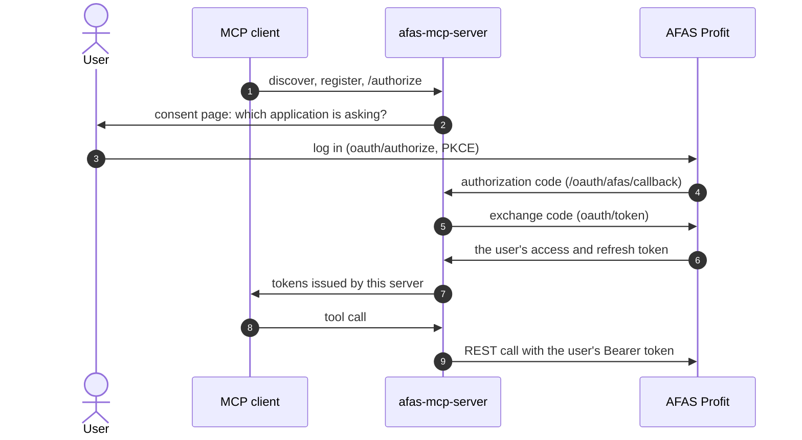

# AFAS MCP Server

[](https://github.com/chruisss/afas_ai_mcp_connector/actions/workflows/ci.yaml)
[](https://github.com/chruisss/afas_ai_mcp_connector/blob/main/LICENSE)
[](https://www.python.org)

A [Model Context Protocol](https://modelcontextprotocol.io) server for [AFAS Profit](https://www.afas.nl) that
every user logs in to with their own AFAS account. You deploy it once for your organisation; assistants such as
Claude Code, Claude Desktop or Cursor connect to it by URL, send the user through the AFAS login, and then read
data through your GetConnectors with exactly the rights that user has in AFAS.

- **AFAS OAuth 2.0, per user.** Authorization code flow with PKCE against an AFAS app connector. There is no
  shared token: every call reaches AFAS with the access token of the user who made it.
- **Read-only by default.** Insert, update and delete tools exist only when `AFAS_ALLOW_WRITES=true`.
- **AFAS tokens stay on the server.** They are stored encrypted; MCP clients only get tokens issued by this
  server.
- **Nothing bundled.** Connectors and fields are discovered from AFAS metainfo, and write payloads are checked
  against the UpdateConnector schema before anything is sent.

The OAuth 2.0 flow follows AFAS's published documentation and has been tested against a live AFAS environment.
Start on an AFAS **test** environment all the same.

## How it fits together



The server sits between two OAuth 2.0 conversations. Towards MCP clients it is an authorization server; towards
AFAS it is a confidential client of your app connector. A tool call is only forwarded when the caller's MCP token
maps to a stored AFAS login, and AFAS decides what that user may see.

## Quick start

You need an AFAS environment where you can create an OAuth app connector, a host with Docker, and a hostname with
TLS in front of it. The steps below are the short version of
[Getting started](docs/tutorials/getting-started.md).

1. **Create the app connector in AFAS.** Authentication type **OAuth**, confidential client, authorization code
   flow, with redirect URL `https://afas-mcp.example.com/oauth/afas/callback` (your own hostname). Link the
   GetConnectors the assistant may read and the authorisation group that may log in.

2. **Configure.** Copy `.env.example` to `.env` and fill in the member id, the client id and secret, the public
   URL and an encryption key:

   ```bash
   python -c "import base64, os; print(base64.urlsafe_b64encode(os.urandom(32)).decode())"
   ```

3. **Run.**

   ```bash
   docker compose up -d --build
   ```

   The container listens on port 8000 and publishes nothing on the host; point your reverse proxy at it. See
   [Deploy with Docker Compose](docs/how-to/deploy-with-docker-compose.md).

4. **Connect.** Users add the server by URL, for example in Claude Code:

   ```bash
   claude mcp add --transport http afas https://afas-mcp.example.com/mcp
   ```

   The client opens a browser, the user confirms and logs in at AFAS, and the assistant can answer questions such
   as *"Which AFAS connectors can you use?"* or *"Show the ten most recently changed employees."*

## Tools

| Tool | Changes data | Purpose |
| --- | --- | --- |
| `afas_connection_info` | no | Which environment the server talks to; proves the user's AFAS login works. |
| `afas_list_connectors` | no | GetConnectors and UpdateConnectors available to the user, with keyword search. |
| `afas_describe_get_connector` | no | Field ids, labels, types and lengths of a GetConnector. |
| `afas_describe_update_connector` | no | Fields, mandatory flags, allowed values and nested objects of an UpdateConnector. |
| `afas_get_rows` | no | One page of rows with filters, sort order and paging metadata. |
| `afas_validate_payload` | no | Check an UpdateConnector payload against its schema and show the body that would be sent. |
| `afas_insert` | **yes** | Create records (HTTP POST). Only with `AFAS_ALLOW_WRITES=true`. |
| `afas_update` | **yes** | Change records (HTTP PUT). Only with `AFAS_ALLOW_WRITES=true`. |
| `afas_delete` | **yes** | Delete one record (HTTP DELETE). Only with `AFAS_ALLOW_WRITES=true`. |

The full parameter reference is in [docs/reference/tools.md](docs/reference/tools.md).

## Configuration

Settings come from `AFAS_*` environment variables. The first five are required.

| Variable | Default | Effect |
| --- | --- | --- |
| `AFAS_MEMBER_ID` | | AFAS Online environment number. Required unless `AFAS_BASE_URL` is set. |
| `AFAS_OAUTH_CLIENT_ID` | | Client id of the AFAS app connector with authentication type OAuth. |
| `AFAS_OAUTH_CLIENT_SECRET` | | Client secret of that app connector. |
| `AFAS_PUBLIC_URL` | | The `https` URL users reach the server on. |
| `AFAS_ENCRYPTION_KEY` | | Fernet key that encrypts the stored AFAS tokens. |
| `AFAS_ENVIRONMENT` | `production` | `production`, `test` or `accept`; selects `rest`, `resttest` or `restaccept`. |
| `AFAS_ALLOW_WRITES` | `false` | Register the insert, update and delete tools. |
| `AFAS_DATABASE_PATH` | `afas-mcp-server.sqlite3` | SQLite file with registered MCP clients and encrypted AFAS tokens. |

The remaining variables, the command-line flags and the HTTP paths are in
[docs/reference/configuration.md](docs/reference/configuration.md).

## Security

- **Credentials.** The client secret and the encryption key are credentials for your ERP and HR data. Keep them in
  your deployment's secret store or a `.env` file that is not committed; never paste them into a prompt.
- **Stored data.** The server stores each user's AFAS tokens, encrypted, in one SQLite file. Whoever has both that
  file and `AFAS_ENCRYPTION_KEY` has those tokens; keep them apart.
- **Reach.** Anyone who can reach the URL can register an MCP client and open the consent page. Only AFAS users in
  the authorisation group of the app connector get past the AFAS login.
- **Where answers go.** What a user's assistant reads from AFAS goes to the AI provider of that user's MCP client.
- **Audit.** Every AFAS call is logged with the user it was made as, on the logger `afas_mcp_server.audit`.

Report vulnerabilities as described in [SECURITY.md](https://github.com/chruisss/afas_ai_mcp_connector/blob/main/SECURITY.md).

## Documentation

The docs are plain Markdown under [docs/](docs/).

- **Tutorial:** [Getting started](docs/tutorials/getting-started.md)
- **How-to:** [Deploy with Docker Compose](docs/how-to/deploy-with-docker-compose.md) · [Connect an MCP client](docs/how-to/connect-an-mcp-client.md) · [Operate the server](docs/how-to/operate-the-server.md) · [Enable writes safely](docs/how-to/enable-writes-safely.md)
- **Reference:** [Tools](docs/reference/tools.md) · [Configuration](docs/reference/configuration.md)
- **Explanation:** [About AFAS MCP Server](docs/explanation/about.md)

## Developing

Prerequisite: [uv](https://docs.astral.sh/uv/).

```bash
uv run pytest                   # tests against a fake AFAS; fails below 100% coverage
uv run ruff check src tests     # lint
uv run ruff format src tests    # format
uv run ty check src             # types
scripts/audit.sh                # known vulnerabilities in the locked dependencies
scripts/smoke-test.sh           # builds the image and probes it
```

CI runs the same checks on every pull request, on Python 3.11 to 3.14.

The rules for changes, for people and AI agents alike, are in
[AGENTS.md](https://github.com/chruisss/afas_ai_mcp_connector/blob/main/AGENTS.md); issues and pull requests are welcome.

## Contact

Chris Schrijver, <chris@tjermo.nl>. Use GitHub issues for bugs and questions, and
[SECURITY.md](https://github.com/chruisss/afas_ai_mcp_connector/blob/main/SECURITY.md) for vulnerabilities.

## Origin

This project started as a fork of
[schubergphilis/afas_mcp_server](https://github.com/schubergphilis/afas_mcp_server) by Ellert van der Vecht, which
connects to AFAS with one classic app connector token over stdio. This project replaced that with AFAS OAuth 2.0 per
user and is developed independently. The tools, filters and payload validation come from the original.

## License

[Apache-2.0](https://github.com/chruisss/afas_ai_mcp_connector/blob/main/LICENSE). AFAS and AFAS Profit are trademarks of AFAS Software B.V.; this project is not affiliated with AFAS.
